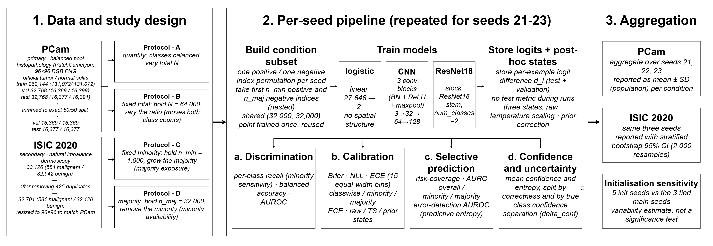

# A Controlled Decomposition of Training-Data Quantity and Class Allocation: Minority-Class Reliability in Medical Image Classification

[](https://doi.org/10.5281/zenodo.23420755)
[](LICENSE)
[](https://doi.org/10.5281/zenodo.23420755)
[](https://www.python.org/)
[](https://pytorch.org/)
[](#datasets)
[](#reproducibility)

This repository provides the complete experimental codebase, per-run stored logits, aggregated numeric results, and generated figures for a controlled study of how training-data composition affects reliability in medical image classification. The study separates two things that observed imbalance normally conflates, how much training data there is and how it is allocated across classes, by moving through the training-data plane spanned by the minority count and the majority count along four protocols. Three models (a linear baseline, a plain convolutional network, and a residual network) are trained from scratch under a fixed compute budget, with three seeds per condition. Reliability is measured class-conditionally alongside the usual pooled summaries, and two post-hoc remedies (temperature scaling and known-prior correction) are tested against the minority gap. PatchCamelyon is the primary dataset, with ISIC 2020 as a secondary check under natural imbalance.

## Authors

| # | Author | Affiliation | ORCID |
| --- | --- | --- | --- |
| 1 | Hrushikesh Sanap (corresponding) | Independent Researcher, Chhatrapati Sambhajinagar, India | [0009-0004-1927-6493](https://orcid.org/0009-0004-1927-6493) |
| 2 | Vikul J. Pawar | Department of Computer Science and Engineering, Government College of Engineering, Chhatrapati Sambhajinagar, Maharashtra 431005, India | [0000-0002-6977-881X](https://orcid.org/0000-0002-6977-881X) |
| 3 | Yashwant Dongre | Department of Computer Engineering, Vishwakarma Institute of Technology, Pune, Maharashtra 411037, India | [0000-0002-4312-8704](https://orcid.org/0000-0002-4312-8704) |
| 4 | Anirban Jyoti Hati | Department of Electronics Engineering, National Institute of Electronics and Information Technology (NIELIT), Chhatrapati Sambhajinagar, Maharashtra 431004, India | [0000-0003-3006-9810](https://orcid.org/0000-0003-3006-9810) |

Corresponding author: Hrushikesh Sanap (hrushisanap@outlook.com).

**Status:** preprint. A preprint of this work is archived on Zenodo at [10.5281/zenodo.23420755](https://doi.org/10.5281/zenodo.23420755) under CC BY 4.0. The manuscript is in preparation and has not been submitted to a journal. This repository accompanies the preprint and will be updated as the work progresses.

> This is research code released for transparency and reproducibility. It uses public benchmark data and is not a clinical tool. None of the results should be read as a claim of clinical performance.

## Overview

The codebase implements an end-to-end, resumable pipeline for:

- **Controlled task construction.** Each training condition is a single point on the (minority, majority) plane, built by nested subsampling from a fixed pool so that larger conditions contain the smaller ones along the same axis and shared points are byte-identical across protocols. The minority is always the positive (tumour) class.
- **Four protocols.** Protocol A varies the total size N at balance; Protocol B varies the class ratio at a fixed total of N = 64,000; Protocol C grows the majority at a fixed minority of 1,000; Protocol D removes minority examples at a fixed majority of 32,000. Reading minority metrics along C and D gives the two single-variable trajectories whose combination appears along B.
- **A three-rung model ladder.** Logistic regression, a plain CNN, and ResNet-18, all trained from scratch (no pretraining, no ImageNet weights) under a fixed budget of 5,000 optimisation steps at batch size 128, in full fp32.
- **Class-conditional reliability.** Minority and majority calibration (ECE, classwise ECE), proper scores (Brier, NLL), and selective-prediction diagnostics (risk-coverage, AURC) are reported alongside the pooled summaries, computed offline from stored logits.
- **Post-hoc remedies.** Temperature scaling and known-prior correction are applied to the stored logits and evaluated against the minority gap specifically, with no retraining.
- **Multi-seed aggregation.** Every condition is run on seeds 21, 22, and 23 (data selection, initialisation, and loader order tied per seed), reported as mean and population standard deviation.
- **A second domain.** ISIC 2020 repeats the fixed-minority protocol under natural rather than constructed imbalance.



*Study design. Stage 1 builds the fixed balanced evaluation sets and defines the training conditions as points on the (minority, majority) plane. Stage 2, per seed, constructs each condition, trains the three models from scratch, and stores logits for scoring in raw, temperature-scaled and prior-corrected states. Stage 3 aggregates over seeds.*

### Datasets

Two public medical imaging datasets define the two regimes. The controlled experiments use PCam; ISIC 2020 is a secondary consistency check. Neither dataset is redistributed here.

| Role | Dataset | Modality | Minority (positive) class | How imbalance is set |
| --- | --- | --- | --- | --- |
| Primary (controlled) | PatchCamelyon (PCam) | Histopathology, 96x96 RGB | Tumour (metastatic tissue) | Constructed by subsampling a natively balanced training pool |
| Secondary (natural) | ISIC 2020 (SIIM-ISIC Melanoma) | Dermoscopy | Malignant (melanoma) | Natural, roughly 1.8% malignant |

PCam is used through the HuggingFace redistribution `1aurent/PatchCamelyon`, which preserves the official whole-slide-image-separated splits. The two evaluation splits are trimmed once, at load, to an exact 50/50 class ratio by a fixed deterministic rule (balance seed 12345, kept indices saved); the training pool is left untouched. See [Data availability](#data-availability) for sources.

### Key findings

The findings below are stated observationally and in the two domains studied only. They trace to the figures and tables produced by notebook 07.

- **A class-conditional asymmetry exists at balance.** Under balanced training (Protocol A), minority recall was below majority recall for every model at every training size, and minority ECE exceeded majority ECE. Allocation changes therefore acted on a gap that was already present.
- **Allocation change was associated with a hidden minority collapse.** As the ratio moved from balance (Protocol B, fixed N = 64,000), minority recall fell sharply and minority ECE and minority AURC rose for all three models, while AUROC and other pooled, rank-based summaries moved comparatively little. The split by true class is what exposed the failure.
- **The decomposition narrows the description.** Minority reliability deteriorated along both Protocol C (growing majority at fixed minority) and Protocol D (removing minority at fixed majority), so the effect tracks the falling minority share of the training set rather than either count alone.
- **A minority-confidence inversion.** At the most skewed condition, misclassified positives carried higher confidence and lower entropy than correctly classified ones (ResNet-18), the reverse of the ordering at balance. Pooled confidence summaries stayed positive, so a confidence or entropy threshold would not have flagged the failure.
- **Remedies, scoped narrowly.** Temperature scaling lowered aggregate miscalibration but did not remove the class-conditional gap on any model. Known-prior correction largely closed the threshold part of the gap for the CNN and ResNet-18 and over-corrected the linear model.
- **Second domain, same direction.** On ISIC 2020, with the malignant count fixed and the benign count grown, minority recall fell and Brier and minority AURC rose for all three models, the same direction as PCam Protocol C. This is read as corroboration in one further domain, not as evidence of generalisation across medical imaging.

### Results at a glance

Protocol B holds the training total at N = 64,000 and moves the class ratio from balanced (r = 1) to most skewed (r approximately 100). The contrast below is the central result: minority recall collapses and minority calibration error rises steeply, while AUROC barely moves. Values are mean plus or minus population standard deviation over seeds 21, 22, 23. Lower is better for ECE; higher is better for recall and AUROC. Source: `code/07-aggregate-and-figures/07-aggregate-and-figures/results/master_results.csv`.

| Model | Condition | Minority recall | Minority ECE | Pooled ECE | AUROC |
| --- | --- | --- | --- | --- | --- |
| Logistic | r = 1 | 0.5892 ± 0.0048 | 0.1388 ± 0.0027 | 0.0702 ± 0.0018 | 0.7166 ± 0.0013 |
| Logistic | r ≈ 100 | 0.0933 ± 0.0025 | 0.6642 ± 0.0036 | 0.2612 ± 0.0014 | 0.7009 ± 0.0016 |
| CNN | r = 1 | 0.6670 ± 0.0093 | 0.1477 ± 0.0109 | 0.0549 ± 0.0069 | 0.8857 ± 0.0041 |
| CNN | r ≈ 100 | 0.0452 ± 0.0098 | 0.8816 ± 0.0076 | 0.4373 ± 0.0038 | 0.8348 ± 0.0144 |
| ResNet-18 | r = 1 | 0.6317 ± 0.0074 | 0.2572 ± 0.0143 | 0.1270 ± 0.0065 | 0.8962 ± 0.0115 |
| ResNet-18 | r ≈ 100 | 0.0978 ± 0.0028 | 0.8140 ± 0.0021 | 0.4043 ± 0.0012 | 0.8644 ± 0.0023 |

The full set of conditions, metrics, and post-hoc states is in `master_results.csv` (PCam) and `isic_master_results.csv` (ISIC), with per-run ledgers alongside.

## Repository structure

The repository has two top-level folders, `code/` and `figures/`.

```
datawise/
│
├── code/
│   ├── modules/                       # Shared engine, imported by the notebooks
│   │   ├── core.py                    #   data loading, subset construction, models, training, logit export
│   │   └── metrics.py                 #   offline, path-free metric computation (read only at aggregation)
│   │
│   ├── 00-setup/                      # Build balanced-eval indices, confirm pixels and norm stats, write frozen_config.md
│   │   ├── 00-setup.ipynb
│   │   └── 00-setup/                  #   outputs: balanced_eval/, summaries/, logs/, frozen_config.md
│   │
│   ├── 01-protocola-quantity/         # Protocol A: total size N, at balance
│   ├── 02-protocolb-fixedtotal/       # Protocol B: vary ratio at fixed N = 64,000
│   ├── 03-protocolc-fixedminority/    # Protocol C: grow majority, minority fixed at 1,000
│   ├── 04-protocold-fixedmajority/    # Protocol D: remove minority, majority fixed at 32,000
│   ├── 05-isic-external/              # ISIC 2020 secondary check (natural imbalance)
│   ├── 06-init-sensitivity/           # Initialisation-seed sensitivity
│   └── 07-aggregate-and-figures/      # Cross-seed aggregation to master tables and all figures
│       ├── 07-aggregate-and-figures.ipynb
│       └── 07-aggregate-and-figures/
│           ├── results/               #   master_results.csv, runs_ledger.csv, isic_master_results.csv, isic_runs_ledger.csv
│           ├── figures/               #   each figure as .png + .svg with its backing .csv
│           ├── logits/                #   per-run stored logits (val/test)
│           └── ...                    #   balanced_eval/, subsets/, random_permutations/, training_curves/, summaries/, logs/
│
├── figures/                           # Manuscript figure set (PNG + SVG) plus three assembled composites
├── LICENSE                            # MIT
└── README.md
```

Each numbered folder in `code/` holds one notebook and a subfolder of the same name carrying everything that notebook produced. The protocol notebooks (01 to 06) write the same set of artefacts: `condition_registry.csv`, the `subsets/` and `random_permutations/` index files that define each condition, the exported `logits/`, per-condition `results/`, `training_curves/`, `summaries/`, `logs/`, the `balanced_eval/` indices, and the `frozen_config.md` for that run. Notebook 07 gathers these into the master tables and the figures. Stored logits are named by model, counts, and seeds, for example `cnn__m1000_M100000__d21_i21_l21_test.csv`.

## Experimental pipeline

The notebooks are run in order, each reading the frozen outputs of the earlier stages.

1. **`00-setup`** builds the fixed balanced evaluation indices, confirms the pixels are the canonical lossless PCam pixels and the normalisation statistics match the reference, runs a shared-condition consistency check, and writes `frozen_config.md`. It is lightweight setup only, with no training.
2. **`01-protocola-quantity` to `04-protocold-fixedmajority`** run the four PCam protocols. For each condition and seed they construct the subset, train the three models from scratch under the fixed budget, and export validation and test logits. No test metric is computed at this stage; the test set is blind until aggregation.
3. **`05-isic-external`** repeats the fixed-minority protocol on ISIC 2020, and **`06-init-sensitivity`** varies the initialisation seed with data and loader seeds held fixed.
4. **`07-aggregate-and-figures`** reads the stored logits, computes every metric offline through `metrics.py` in raw, temperature-scaled and prior-corrected states, aggregates over seeds, and emits the master tables and all figures with their backing CSVs.

### Pinned configuration

From `frozen_config.md` (config hash `03fa342b535795c1`):

| Setting | Value |
| --- | --- |
| Optimisation steps | 5,000 (500-step warmup then cosine decay) |
| Batch size | 128 |
| Precision | fp32 (AMP off) |
| Fixed total for Protocol B (N) | 64,000 |
| Run seeds (data / init / loader, tied) | 21, 22, 23 |
| Evaluation-balancing seed (separate, fixed) | 12345 |
| Logistic | lr = 3e-4, wd = 1e-2 |
| CNN and ResNet-18 | lr = 3e-4, wd = 1e-4 |
| Normalisation mean | 0.700756, 0.538358, 0.691621 |
| Normalisation std | 0.234978, 0.277409, 0.212895 |

Optimiser AdamW, CrossEntropyLoss on logits, gradient clipping at global norm 1.0, training augmentation (random horizontal and vertical flip, random 90-degree rotation) applied to training data only.

## Figures

The `figures/` folder holds the numbered figure set as PNG and SVG. Each plot is generated by notebook 07 from a backing CSV (the CSVs live under `code/07-aggregate-and-figures/07-aggregate-and-figures/figures/`).

Figure inventory:

| File stem | Content |
| --- | --- |
| `figure_01_plane_schematic` | The (minority, majority) training-data plane and the four protocol paths |
| `figure_02_protocolA_vs_N` | Protocol A: metrics against total training size N (balanced) |
| `figure_03_protocolB_vs_ratio` | Protocol B: metrics against class ratio, fixed N = 64,000 |
| `figure_04_protocolC_vs_nmaj` | Protocol C: metrics against majority count, minority fixed at 1,000 |
| `figure_05_protocolD_vs_nmin` | Protocol D: metrics against minority count, majority fixed at 32,000 |
| `figure_06_decomposition_minority_ece` | Minority ECE along Protocols C, D and B |
| `figure_06b_decomposition_aurc_minority` | Minority AURC along Protocols C, D and B |
| `figure_07_model_ladder` | Model-ladder comparison across the three architectures |
| `figure_08_reliability_resnet18` | Per-class top-label reliability diagrams (ResNet-18) |
| `figure_09_risk_coverage_resnet18` | Selective risk against coverage (ResNet-18), overall and per class |
| `figure_10_conf_entropy` | Mean confidence and entropy by class and correctness (ResNet-18) |
| `figure_11_recalibration_states` | Minority and classwise ECE in raw, prior-corrected and temperature-scaled states (Protocol B) |
| `figure_12_isic` | ISIC 2020: minority recall, AUROC, Brier and minority AURC against benign count |
| `figure_13_init_sensitivity` | Initialisation-seed sensitivity of minority ECE |
| `figure_14_training_curves` | Training curves under the fixed compute budget |

## Reproducibility

### Environment

The runs were produced on Kaggle notebooks with a single NVIDIA Tesla T4 GPU. The recorded environment is Python 3.13, PyTorch 2.11.0 with CUDA 12.8, torchvision 0.26.0, NumPy 2.1.3, pandas 2.3.3, and scikit-learn 1.6.1.

```bash
# Clone the repository
git clone https://github.com/HrushiSanap/datawise.git
cd datawise

# Suggested install
pip install torch torchvision numpy pandas scikit-learn matplotlib
```

The shared engine is in `code/modules/`. On Kaggle it is carried as a dataset and imported through `sys.path`, or written to the working directory; the image data is mounted read-only and never downloaded inside a run.

### Fast verification (from the stored logits)

A CPU is sufficient. The stored per-run logits under each stage's output folder let every metric, table, and figure be regenerated without retraining.

1. Confirm the logit CSVs are present under the protocol output folders and under `07-aggregate-and-figures/07-aggregate-and-figures/logits/`.
2. Run `code/07-aggregate-and-figures/07-aggregate-and-figures.ipynb` to recompute all metrics offline through `metrics.py`, aggregate over seeds, and rebuild the master tables and figures.

### Full replication (training from scratch)

A GPU with roughly 16 GB of memory is recommended; the full set of runs is about 20 to 24 GPU-hours and is resumable by run id and config hash. Run `00-setup`, then the protocol notebooks `01` to `04`, then `05` and `06`, then `07` to aggregate. Determinism is set through seeded Python, NumPy and torch generators, deterministic cuDNN with benchmarking off, a single-process loader, and full fp32.

### Data availability

The image data is not redistributed in this repository.

- **PatchCamelyon**: the HuggingFace redistribution [`1aurent/PatchCamelyon`](https://huggingface.co/datasets/1aurent/PatchCamelyon), which preserves the official whole-slide-image-separated splits.
- **ISIC 2020 (SIIM-ISIC Melanoma)**: the public [SIIM-ISIC Melanoma Classification](https://challenge2020.isic-archive.com/) training data.

## Citation

If you use this code or these findings, please cite the preprint. The citation will be updated as the manuscript progresses.

```bibtex
@misc{sanap2026datawise,
  author       = {Sanap, Hrushikesh and Pawar, Vikul J. and Dongre, Yashwant and Hati, Anirban Jyoti},
  title        = {A Controlled Decomposition of Training-Data Quantity and Class Allocation:
                  Minority-Class Reliability in Medical Image Classification},
  year         = {2026},
  publisher    = {Zenodo},
  doi          = {10.5281/zenodo.23420755},
  url          = {https://doi.org/10.5281/zenodo.23420755},
  note         = {Preprint; manuscript in preparation}
}
```

## License

The code in this repository is released under the MIT License. See [LICENSE](LICENSE) for details. The MIT terms cover the code only.

The preprint and the figures are licensed under Creative Commons Attribution 4.0 International (CC BY 4.0), matching the Zenodo record. The underlying image datasets are governed by their own licences, described at the sources above, and are not redistributed here.

## Acknowledgments and data credits

This study relies on public datasets and tooling produced by others.

- **PatchCamelyon** derives from the CAMELYON16 whole-slide images and was introduced by Veeling and colleagues; the splits are used through the HuggingFace redistribution `1aurent/PatchCamelyon`.
- **ISIC 2020** is the SIIM-ISIC Melanoma Classification dataset, released by the International Skin Imaging Collaboration and collaborators.
- The experiments are built on PyTorch, torchvision, and scikit-learn.

A closely related, published study by the first author on calibration and reliability across the MedMNIST benchmark is available at [10.1007/s00521-026-12521-1](https://doi.org/10.1007/s00521-026-12521-1); the present work differs in using PatchCamelyon and in being a controlled decomposition of quantity versus allocation rather than a benchmark-wide survey.

## References

- Veeling, B. S., Linmans, J., Winkens, J., Cohen, T., Welling, M. (2018). Rotation equivariant CNNs for digital pathology. *MICCAI 2018*, LNCS 11071, 210-218. https://doi.org/10.1007/978-3-030-00934-2_24 (PatchCamelyon)
- Ehteshami Bejnordi, B., Veta, M., van Diest, P. J., et al. (2017). Diagnostic assessment of deep learning algorithms for detection of lymph node metastases in women with breast cancer. *JAMA*, 318(22), 2199-2210. https://doi.org/10.1001/jama.2017.14585 (CAMELYON16)
- Rotemberg, V., Kurtansky, N., Betz-Stablein, B., et al. (2021). A patient-centric dataset of images and metadata for identifying melanomas using clinical context. *Scientific Data*, 8, 34. https://doi.org/10.1038/s41597-021-00815-z (ISIC 2020)
- Guo, C., Pleiss, G., Sun, Y., Weinberger, K. Q. (2017). On calibration of modern neural networks. *ICML*, 1321-1330. https://doi.org/10.48550/arXiv.1706.04599 (Temperature scaling, ECE)
- Saerens, M., Latinne, P., Decaestecker, C. (2002). Adjusting the outputs of a classifier to new a priori probabilities: a simple procedure. *Neural Computation*, 14(1), 21-41. https://doi.org/10.1162/089976602753284446 (Known-prior correction)
- Nixon, J., Dusenberry, M. W., Jerfel, G., et al. (2019). Measuring calibration in deep learning. *CVPR Workshops*. https://doi.org/10.48550/arXiv.1904.01685 (Class-conditional calibration)
- Kull, M., Perello-Nieto, M., Kängsepp, M., Silva Filho, T., Song, H., Flach, P. (2019). Beyond temperature scaling: obtaining well-calibrated multi-class probabilities with Dirichlet calibration. *NeurIPS*. arXiv:1910.12656 (Classwise ECE)
- Sanap, H. (2026). Beyond accuracy: calibration and uncertainty in multi-architecture ensembles for MedMNIST classification. *Neural Computing and Applications*, 38(19), 776. https://doi.org/10.1007/s00521-026-12521-1 (Prior work by the author)
